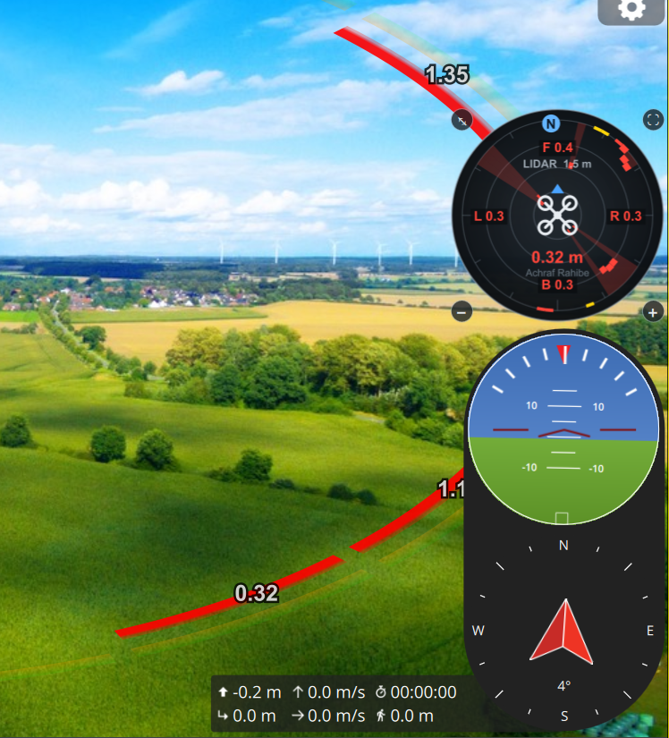
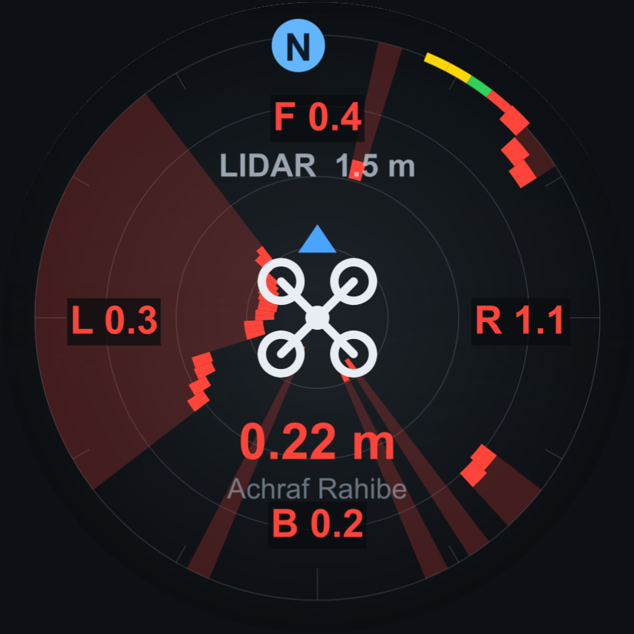
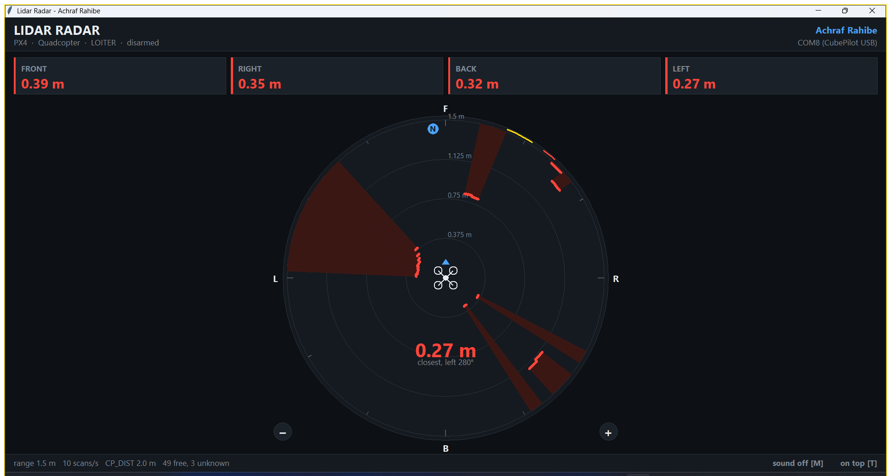
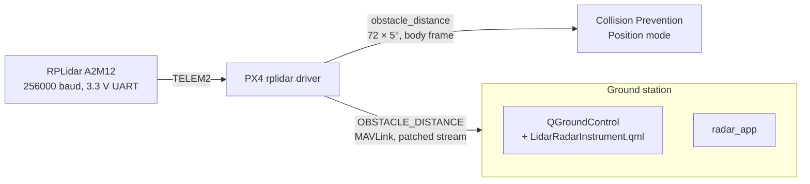

# 360° Lidar Obstacle Avoidance for PX4 and ArduPilot

**A Slamtec RPLidar A2M12 wired straight to the flight controller (no companion computer), with
a new PX4 driver, two PX4 fixes, a radar display inside QGroundControl and a desktop radar app.**

Tested on a **Holybro Pixhawk 6X** and a **CubePilot Cube Orange Plus** (PX4 v1.17.0), and with
ArduCopter 4.7 on the Pixhawk 6X.



---

## Why

ArduPilot supports RPLidar scanners out of the box. **PX4 does not**: up to v1.17.0 there is no
RPLidar driver, and PX4's Collision Prevention only works with a companion computer or a
supported range sensor. This project adds the missing pieces so a 360° lidar can feed PX4's
Collision Prevention directly over a serial port, and makes the scan visible to the pilot.

## What's in it

| Part | What it does |
|---|---|
| [`px4_rplidar/`](px4_rplidar) | **PX4 driver** for RPLidar scanners (`rplidar start -d <port>`). Publishes `obstacle_distance` (72 sectors × 5°) for Collision Prevention. Host test bench with a simulated lidar (10 scenarios). |
| [`px4_rplidar/patches/`](px4_rplidar/patches) | **Three PX4 fixes**: keep the 5 V peripheral rail on at boot (Pixhawk 6X, Cube Orange Plus) and send the raw scan to the ground station when Collision Prevention is idle. |
| [`qgc/`](qgc) | **Radar inside QGroundControl**: a QML instrument loaded from QGC's settings, no QGC rebuild. |
| [`radar_app/`](radar_app) | **Desktop radar** (Python), auto-detects the flight controller, parking-sensor beeps. |
| [`ardupilot/`](ardupilot) | ArduCopter parameters for the same lidar (native ArduPilot support). |
| [`firmware/`](firmware) | Built PX4 firmware for the Pixhawk 6X and the Cube Orange Plus. |
| [`ubuntu/`](ubuntu) | Scripts to set up the toolchains and build everything on Ubuntu. |

## Results

| | Pixhawk 6X | Cube Orange Plus |
|---|---|---|
| Lidar port | TELEM2 (`/dev/ttyS4`) | TELEM2 (`/dev/ttyS1`) |
| Scan rate | ~20 Hz, ~184 samples/turn | ~22 Hz, ~183 samples/turn |
| Sectors filled per scan | 71–72 of 72 | 72 of 72 |
| Cold starts (USB unplugged) | 4 of 4 streaming first try | 1 of 1 streaming first try |
| Errors / resyncs | 0 / 0 | 0 / 0 |
| Firmware flash used | 97.0 % (`multicopter` variant) | 99.4 % (`default`) |

Not yet done: **flight testing** and an outdoor test of Collision Prevention in Position mode.

<p>


</p>

## How it works



**The driver** (`px4_rplidar/src/drivers/distance_sensor/rplidar/`) talks the RPLidar legacy scan
protocol: STOP → GET_HEALTH → GET_INFO → SCAN, then decodes 5-byte samples. It keeps the closest
return per 5° sector and publishes one `obstacle_distance` message per revolution, projected onto
the horizontal plane using the vehicle attitude. Sectors swept with no return are reported as
free; sectors never sampled as unknown. It restarts the sensor after 1 s without data, handles an
upside-down mount (`RPL_ORIENT_CFG`) and a yaw offset (`RPL_YAW_OFF`), and `rplidar status` shows
the model, health, scan rate, byte counters and error counters.

**Parameters**

| Parameter | Meaning |
|---|---|
| `SENS_RPLIDAR_CFG` | serial port (e.g. 102 = TELEM 2) |
| `RPL_BAUD` | 256000 for the A2M12 |
| `RPL_YAW_OFF` | direction the lidar's front points, degrees clockwise from the vehicle's nose |
| `RPL_ORIENT_CFG` | 0 upright, 1 upside down |
| `RPL_MIN_DIST`, `RPL_MAX_DIST` | usable range (m); returns closer than the minimum (e.g. the frame) are ignored |
| `CP_DIST` | Collision Prevention stopping distance (PX4) |

## The bug that took a day: "the lidar works on ArduPilot but not on PX4"

On the first PX4 test the driver sent its commands and **received zero bytes**, although the motor
spun and the same wiring worked under ArduPilot. Narrowing it down, step by step:

1. **Byte counters in the driver** showed 0 bytes received, so it was not a parsing bug.
2. **Software path checked against ArduPilot:** same UART5 and pins, same baud (NuttX passes 256000
   through as `BOTHER`), flow control off, inversion off, RX DMA polled every 1 ms. All fine.
3. **A/B test:** after flashing ArduCopter back, the lidar was silent there too, until **the lidar alone
   was power-cycled**. The lidar had hung.
4. **Started the driver by hand a minute after boot:** still hung → not the driver's commands.
5. **Board code:** PX4's Pixhawk 6X configuration starts the 5 V peripheral rail **off** in its early
   GPIO setup and switches it on later, so every PX4 boot gives TELEM devices a short power cut in the
   middle of their own start-up. ArduPilot keeps the rail on.

**Fix:** start the rail on, as ArduPilot does (`fmu-v6x-5v-rails-on-at-boot.patch`). Result: 4 of 4
cold starts streaming on the first try. The Cube Orange Plus has the same pattern and gets the same
fix.

## Hardware and wiring

RPLidar A2M12 connector: red 5 V, yellow TX, green RX, black GND, blue MOTOCTL (3.3 V UART, 256000
baud, 5 V supply up to 1.5 A at start-up).

| Lidar wire | Flight controller |
|---|---|
| Red (5 V) | 5 V BEC ≥ 3 A (bench: TELEM2 pin 1) |
| Green (lidar RX) | TELEM2 pin 2 (TX) |
| Yellow (lidar TX) | TELEM2 pin 3 (RX) |
| Black (GND) | TELEM2 pin 6 and BEC ground |
| Blue (MOTOCTL) | 5 V (must be high or the motor does not spin) |

The flight controller's own 5 V rail measured 4.1–4.6 V on USB, below the lidar's 4.9 V minimum:
**use a BEC for flight**. Mount the lidar level, high enough that props and the GPS mast do not block
it, front (the side opposite the cable) towards the nose, or set `RPL_YAW_OFF`.

## Quick start (PX4)

```bash
# on Ubuntu 22.04/24.04 with PX4-Autopilot v1.17.0 checked out
bash ubuntu/01_setup_px4.sh                     # toolchain
bash ubuntu/02_build_px4_rplidar.sh             # tests, installs driver + patches, builds Pixhawk 6X
BOARD=cubepilot_cubeorangeplus_default \
BOARD_CONFIG=boards/cubepilot/cubeorangeplus/default.px4board \
bash ubuntu/02_build_px4_rplidar.sh             # Cube Orange Plus
```

Flash with QGroundControl (Firmware → Advanced → Custom firmware file), then set
`SENS_RPLIDAR_CFG` = TELEM 2, make sure no MAVLink instance uses TELEM2 (`MAV_1_CONFIG` = 0), set
`CP_DIST`, reboot, and check in the MAVLink console:

```
rplidar status
listener obstacle_distance
```

ArduPilot: load [`ardupilot/rplidar_a2m12_telem2.param`](ardupilot/rplidar_a2m12_telem2.param)
(`SERIAL2_PROTOCOL` 11, `SERIAL2_BAUD` 256, `PRX1_TYPE` 5).

## Radar in QGroundControl

Add one line to QGroundControl's settings file (QGC closed). Details are in [`qgc/README.md`](qgc/README.md):

```ini
[FlyView]
instrumentQmlFile2=file:///path/to/qgc/LidarRadarInstrument.qml
```

Above the attitude instrument; drag to move, double-click to dock, mouse wheel = range,
Ctrl + wheel or the corner grip = size, ⛶ = full screen. Front matches the flight controller's
arrow; red inside `CP_DIST`, yellow up to twice that, green beyond; the vehicle icon follows the
vehicle type; "NO LIDAR DATA" if the scan stops.

## Desktop radar

Windows: double-click `radar_app/Start Lidar Radar.bat`. Ubuntu: `radar_app/start_lidar_radar.sh`.
See [`radar_app/README.md`](radar_app/README.md).

## Testing

- `px4_rplidar/test/test_protocol.cpp`: protocol decoding.
- `px4_rplidar/test/host_sim`: compiles the real driver against stand-ins for PX4 and runs it
  against a simulated lidar: normal scan, motor off, corrupted bytes, health error and reset,
  upside-down, yaw offset, no sensor, split reads, 30° pitch, 5 Hz scan.
- Bench tests on both flight controllers (above).

## Limits and next steps

- Flight tests and an outdoor Collision Prevention test (needs GPS / Position mode).
- PX4 Collision Prevention acts only in Position mode; ArduPilot's simple avoidance stops in Loiter.
- The Cube Orange Plus firmware is at 99.4 % flash.
- The QGC instrument was tested with QGroundControl Daily v5.0.3; future QGC versions may need
  small QML changes.

## License

BSD 3-Clause (same as PX4), see [LICENSE](LICENSE). The patches modify PX4 files and stay under
PX4's BSD 3-Clause license.

**Author:** Achraf Rahibe · [portfolio](https://hrafrh.github.io/) · [GitHub](https://github.com/HRAFRH)
